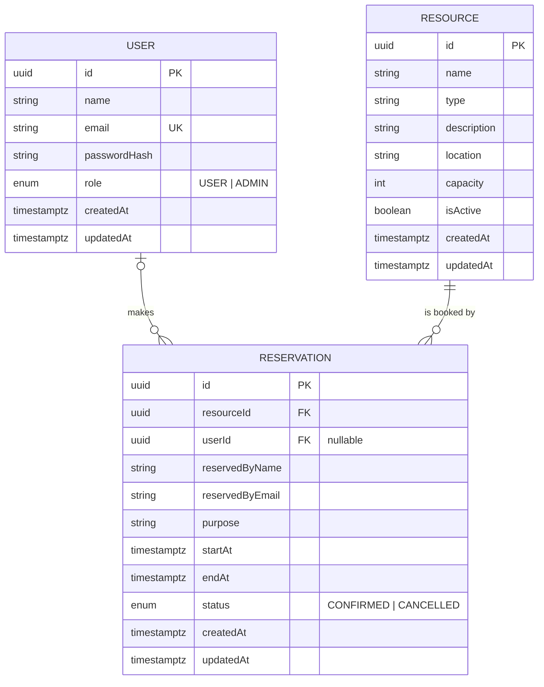

# ReserveX: ER Diagram

## Database rules

- `Reservation.resourceId` uses `ON DELETE RESTRICT`: a resource with booking history cannot be deleted, only deactivated.
- `Reservation.userId` uses `ON DELETE SET NULL`: bookings survive if a user is removed.
- `CHECK (endAt > startAt)` on `Reservation`.
- `CHECK (capacity IS NULL OR capacity > 0)` on `Resource`.
- Exclusion constraint `Reservation_no_overlap` (GiST on `resourceId` and `tstzrange(startAt, endAt, '[)')`, applied only where `status = 'CONFIRMED'`). Overlapping confirmed bookings for one resource are impossible, while back-to-back bookings and cancelled bookings are allowed.