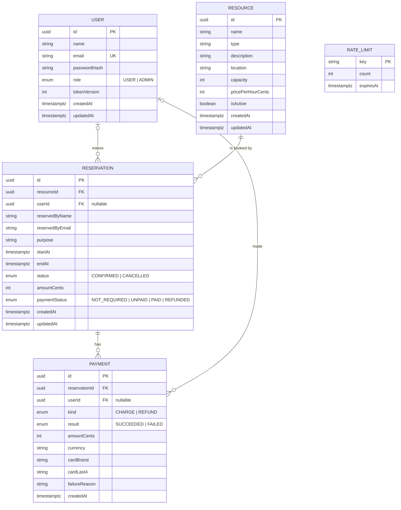

# ReserveX: ER Diagram

## Database rules

- `Reservation.resourceId` uses `ON DELETE RESTRICT`: resources with booking history cannot be deleted; they can be deactivated.
- `Reservation.userId` uses `ON DELETE SET NULL`: bookings survive if a user is removed.
- `Payment.reservationId` uses `ON DELETE RESTRICT`: reservations referenced by payment history cannot be deleted.
- `Payment.userId` uses `ON DELETE SET NULL`: payment history survives if a user is removed.
- `CHECK (endAt > startAt)` on `Reservation`.
- `CHECK (capacity IS NULL OR capacity > 0)` on `Resource`.
- Monetary constraints:
  - `CHECK (pricePerHourCents >= 0)` on `Resource`.
  - `CHECK (amountCents >= 0)` on `Reservation`.
  - `CHECK (amountCents >= 0)` on `Payment`.
  - Check constraints keep money non-negative, free bookings at 0 and paid bookings above 0.
- Unique indexes allow one successful charge and one successful refund per reservation. Failed payment attempts do not consume these successful-payment slots.
- Exclusion constraint `Reservation_no_overlap` uses GiST on `resourceId` and `tstzrange(startAt, endAt, '[)')`, applied only where `status = 'CONFIRMED'`. Overlapping confirmed bookings for one resource are prevented, while back-to-back and cancelled bookings are allowed.
- Free reservations use `paymentStatus = NOT_REQUIRED`; reservations requiring payment begin with `UNPAID`. Successful payment updates the reservation to `PAID`, and a successful refund updates it to `REFUNDED`.
